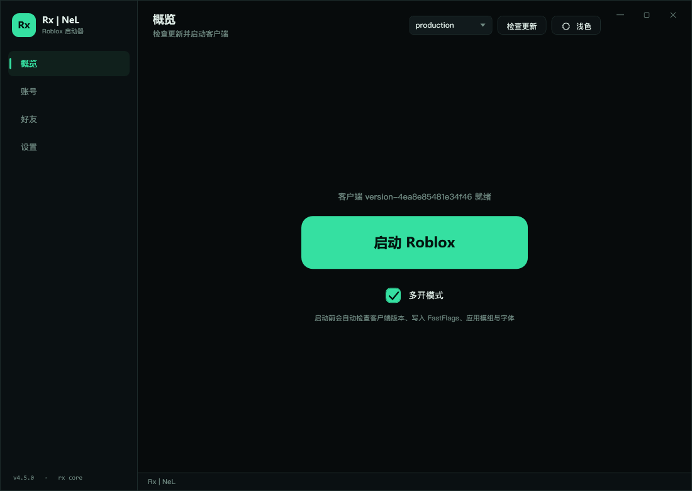
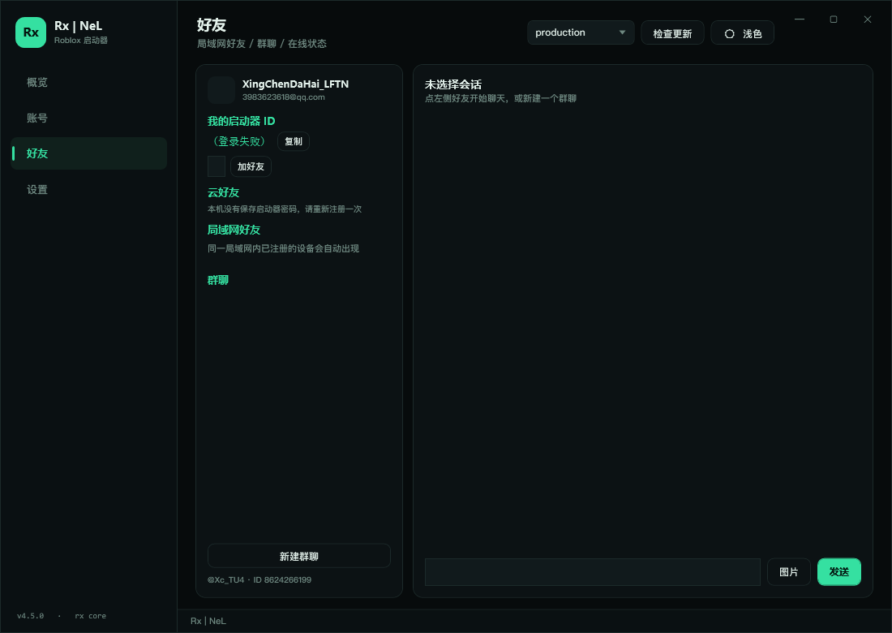
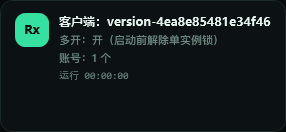
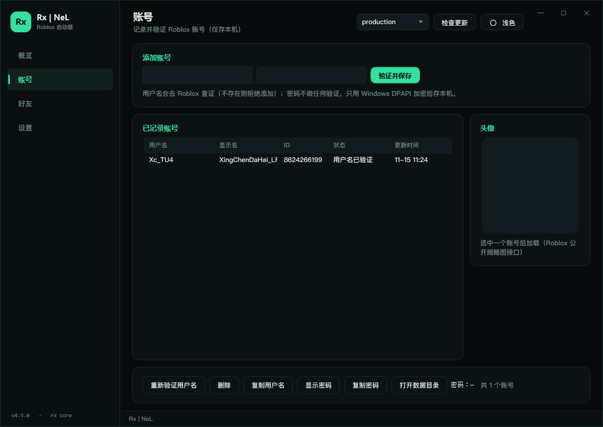
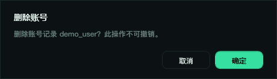
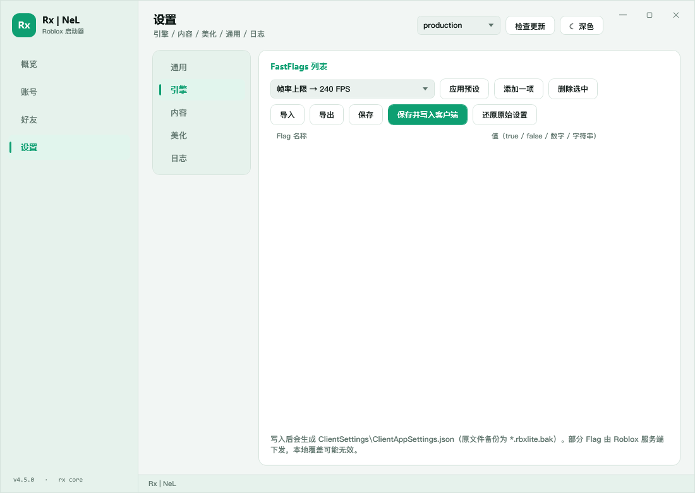
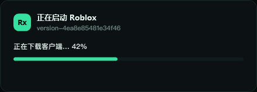

# Rx | NeL v4.4.0 — WPF 渲染后端

把启动器的 UI 层从 WinForms 换成 **WPF（Direct3D 合成）**，业务层完全复用原工程
`D:\DSH\RbxLite` 里的服务代码，没有复制粘贴：新工程通过 `<Compile Include="..\RbxLite\*.cs">`
链接了 18 个业务文件。

## 为什么要换

WinForms 走 GDI+ 软件绘制，这台机器（VMware，无 GPU 加速）单页全量重绘要 200~400 ms，
切页能明显看到停顿，上一轮把卡片改直角、关抗锯齿也只压到 50~400 ms。

WPF 用 D3D 合成，控件树由渲染线程合成，实测切页：

```
[切页] 概览: 0 ms
[切页] 引擎: 29 ms
[切页] 内容: 13 ms
[切页] 美化: 29 ms
[切页] 设置: 13 ms
[切页] 日志: 16 ms
```

## 结构

```
RxNeL/
├── RxNeL.csproj           WPF 工程，链接 ..\RbxLite 的业务代码
├── App.xaml / App.xaml.cs 入口：命令行、单实例、遮罩 + 主窗口
├── Themes/
│   ├── Light.xaml / Dark.xaml      两套颜色字典（同名 Brush 键）
│   └── Styles.xaml                 卡片 / 按钮 / 导航 / 输入框 / DataGrid / ComboBox 模板
├── ThemeManager.cs        主题切换：替换 MergedDictionaries[0]
├── Runtime.cs             运行态 + ClientManager（检查/安装/启动/多开）
├── SplashWindow.xaml      独立启动画面（环形动画用 WPF 动画，走渲染线程）
├── MainWindow.xaml        无边框窗口 + 侧边栏导航 + 顶栏 + 状态栏
├── Accounts/              账号库（DPAPI 加密）+ Roblox 校验
├── Views/
│   ├── LaunchView         概览：启动按钮 / 多开开关
│   ├── AccountsView       账号：记录与校验
│   ├── SettingsHubView    设置总入口：左侧二级导航（通用/引擎/内容/美化/日志）
│   ├── SettingsView       通用：主题、行为、语言、Discord、模板、自更新
│   ├── FlagsView          引擎：FastFlags 表格 + 预设
│   ├── ModsView           内容：模组覆盖
│   ├── AppearanceView     美化：字体替换 / 独显
│   └── LogView            日志（虚拟化列表）
└── UiTest.cs              RenderTargetBitmap 逐页导出浅色/深色截图
```

## 逻辑复用

`RxNeL.csproj` 里这 18 个文件直接链接自 `RbxLite`，一行没改（除 `SelfTest` 里 7 项
WinForms 调色板断言用 `#if !WPF` 排除）：

`AppInfo / Paths / Logger / Settings / Deployment / LaunchHandler / FastFlagManager /
ModManager / FontModManager / GpuPreference / ProtocolRegistrar / SingleInstance /
DiscordRpc / SingletonBypass / NativeMethods / UpdateChecker / ClientPrep / SelfTest`

界面通过 `ClientManager` 调用它们：检查更新 → 安装 → `ClientPrep.Prepare`（FastFlags / 模组 /
字体 / 显卡偏好）→ `LaunchHandler.Start`；多开开关会先跑 `SingletonBypass`。

## 构建 / 运行

```bat
cd D:\DSH\RxNeL
dotnet build -c Release
dotnet run -c Release

:: 单文件发布（需要 .NET 8 桌面运行时）
dotnet publish -c Release -r win-x64 --self-contained false -p:PublishSingleFile=true -o publish
```

命令行（与原版一致）：

```bat
RxNeL.exe --register / --unregister
RxNeL.exe -player "roblox-player:1+..."
RxNeL.exe --selftest               :: 70 项（业务层）
RxNeL.exe --prepare                :: 启动前准备耗时
RxNeL.exe --font <字体文件> [--all] | --font restore
RxNeL.exe --hold-mutex <名称> [毫秒]
RxNeL.exe --uitest <目录>           :: 逐页渲染浅色/深色截图
```

## 界面

| 概览 · 深色 | 设置 · 浅色 |
|---|---|
|  |  |

| 引擎 · 浅色 | 美化 · 深色 |
|---|---|
|  |  |

窗口仍然是无边框自绘 chrome（`WindowChrome`，`CaptionHeight=0`，`ResizeBorderThickness=6`），
顶栏可拖动、双击最大化，四个边可拉伸；启动时先显示同尺寸 `SplashWindow`（TopMost），
主窗口在下面构建，`Loaded` 后 500 ms 关闭遮罩。

## 实现备注

- **DataGrid 表头**：WPF 默认 `DataGridColumnHeader` 模板在深色下会留一条浅色带、文字不可见，
  索性关掉原生表头（`HeadersVisibility="None"`），用两个 `TextBlock` 自绘表头，颜色跟随主题。
- **ComboBox**：默认模板使用系统配色，这里重写了 `ControlTemplate`（圆角边框 + 自绘箭头 + 弹出层圆角），
  否则深色下会是一块白底。
- **字体预览**：用 `GlyphTypeface` 读取字体文件的族名，再以 `FontFamily(new Uri(path), "./#name")` 加载，
  不需要安装到系统。

## 延迟问题：根因与修复（v4.8.2）

**根因**：启动器把 `roblox-player:` URI 传给客户端时给它加了引号。

URI 里含 `?`、`&`、`=`，旧版 `Quote()` 因此判定"需要引号"：

```csharp
// 旧：带 ? & = 就加引号
var needsQuote = value.IndexOfAny(new[] { ' ', '&', '?', '=', '"' }) >= 0;
```

于是客户端收到的是 `"roblox-player:1+launchmode:play+gameinfo:...` —— 行首多一个 `"`。
客户端对 URI 的解析因此走了另一条加入路径，**服务器分配跟着变**，表现就是同一张图
60ms → 990ms。Bloxstrap 是原样不加引号传递的，所以它正常。

修复：只对空格和引号加引号（`IndexOfAny(new[] { ' ', '"' })`），传出去的字节与 Bloxstrap 一致。
回归测试同步改为断言"不带多余引号"（`SelfTest` 70/70）。

排查过程里顺手加的三个开关仍然保留，以后遇到类似问题可直接切：

| 开关 | 作用 |
|---|---|
| 兼容启动参数 | 改用 `-app -t … --placelauncherurl …`（Bloxstrap 另一条形态） |
| 干净启动 | 完全跳过 FastFlags / 模组 / 字体 / 显卡写入 |
| 网络诊断（`--netdiag`） | 读最近一局日志：数据中心 / 传输方式 / 服务器 IP / 实测延迟 |

## 延迟排查（v4.8.1）

启动器本身不碰网络：参数只有 `{rawUri}`（原样交给客户端）、channel 固定 `production`、
不设代理、`ClientAppSettings.json` 实际内容是 `{}`。所以"经过启动器"不会改路由。

真正会变的是三处，`设置 → 通用 → 排查 → 网络诊断` 会把它们直接打出来：

```bat
> RxNeL.exe --netdiag
版本目录：version-4ea8e85481e34f46
FastFlags：{}
最近一次会话
  数据中心：414
  传输方式：RbxTransport        ← UDP，VPN/代理最容易拖垮的就是它
  服务器：128.116.63.33:55796
实测延迟（ICMP 不可用时退回 TCP 握手）
启动链路：{rawUri} / 多开 开 / 代理 无 / 干净启动 关
```

排查顺序：

1. **看数据中心**：两次启动如果 `DatacenterId` 差很远（比如一次 414 一次 3xx），
   说明匹配到了不同区域，ping 自然差几十倍——这是 Roblox 匹配，不是启动器。
2. **UDP 被劣化**：`selectedTransport=RbxTransport` 走 UDP。开着 VPN/代理/TUN 时
   UDP 常被限速或降级，表现就是 TCP 网站正常、游戏 ping 爆炸。
3. **本地掉帧放大 ping**：Roblox 性能面板的 ping 含客户端处理时间。启动器常驻时的
   HUD（1s 刷新）、局域网心跳（3s 广播）、手机遥控（5s 轮询）在弱机上会把这个数字放大。

于是加了两个开关用于 A/B：

- `干净启动`：不写 FastFlags / 模组 / 字体 / 显卡（`ClientPrep` 直接跳过）
- 关掉 `显示常驻小窗`、`手机遥控`，并把启动器最小化（默认已开 `MinimizeOnLaunch`）

## 手机端（v4.8.0）

桌面启动器是 WPF + Win32（启动 RobloxPlayerBeta、改注册表、DPAPI），**打不了 APK**——
Android 上这些 API 都不存在，不是打包工具的问题。

所以做了「手机遥控」：同一 WiFi 下用手机浏览器访问电脑上的页面。

### 怎么用

1. 电脑：设置 → 通用 → 勾选「手机遥控」→ 重启启动器
2. 页面地址：`http://<电脑IP>:27150/`（状态栏会显示，例如 `http://192.168.1.10:27150`）
3. 手机浏览器打开 → Chrome 菜单「添加到主屏幕」→ 全屏带图标，行为接近 App
4. 首次点「启动 Roblox」要填配对码（日志和状态栏里会显示 6 位数字）

### 能做什么

| 接口 | 作用 |
|---|---|
| `GET /api/status` | 客户端版本、Roblox 是否在跑、多开状态、账号列表 |
| `POST /api/launch` | 启动 Roblox（需 `X-Pair-Code` 头） |
| `GET /` | 手机页面（PWA，可添加主屏幕） |

实现：`MobileServer.cs` 用 `TcpListener` 手写极简 HTTP，不依赖 HttpListener（后者需要 URL ACL/管理员权限）。

### 真要 APK

仓库里已备好 `android/`（WebView 壳，Java + Gradle）和 `.github/workflows/android.yml`：
GitHub Actions 上打 tag 或手动触发 `android-apk` 就会产出 `RxNeL-Companion.apk`（CI 有 Android SDK，
本机没有——`dl.google.com` 和 `maven.google.com` 在这台机器上都是 000）。

## 安装程序（v4.7.0）

```bat
dist\RxNeL-Setup-4.7.0.exe
```

Inno Setup 6 编译，2.3 MB，**不需要管理员权限**（装到 `%LOCALAPPDATA%\Programs\RxNeL`）。

| 安装时做什么 | 说明 |
|---|---|
| 复制程序 | `RxNeL.exe` + `README.md` |
| 开始菜单 | 「Rx | NeL」与卸载入口 |
| 桌面快捷方式 | 勾选「附加任务」时创建 |
| 接管协议 | 勾选后写 `HKCU\Software\Classes
oblox-player`，浏览器点 Play 直接唤起 |
| 卸载 | Inno 自带 `unins000.exe`，会删文件并清掉协议键（不留死链） |

更新时的行为（v4.7.1 起）：

| 你装的是 | 点「检查启动器更新」会发生什么 |
|---|---|
| **安装版**（Setup 装的） | 优先下载 `RxNeL-Setup-*.exe`，静默覆盖安装到原目录（`/VERYSILENT /DIR=<原目录>`）→ 程序、版本号、卸载器一起更新 |
| **绿色版**（单文件 exe） | 下载新 exe 替换自己并重启（原逻辑） |

判断依据：`HKCU\Software\Microsoft\Windows\CurrentVersion\Uninstall\{8B1F4C2A-...}_is1` 是否存在。
自查命令：

```bat
> RxNeL.exe --update-mode
installed=True location=C:\Users\you\AppData\Local\Programs\RxNeL\
local version=4.7.1
```

发布端要求：GitHub Release 放两个资产——`RxNeL.exe`（绿色版）和 `RxNeL-Setup-x.y.z.exe`（安装包），
更新逻辑按文件名区分；自定义清单也可以用 `"setupUrl"` 单独指定安装包地址。

静默安装（部署/脚本用）：

```bat
RxNeL-Setup-4.7.0.exe /VERYSILENT /SUPPRESSMSGBOXES /NORESTART
```

源码脚本：[`installer/RxNeL.iss`](installer/RxNeL.iss)。本机编译：

```bat
"%LOCALAPPDATA%\Programs\Inno Setup 6\ISCC.exe" installer\RxNeL.iss
```

GitHub Actions 也加了这一步（打 tag 时自动编译安装包并一起上传）。

## 验证系统已移除（v4.7.0）

邮箱验证码、确认链接、启动器密码全部删除。开通好友功能只剩一步：



```
填 Roblox 用户名 → 一键开通 → 得到 RX-XXXXXX
```

底层用的是 Supabase **匿名登录**（`POST /auth/v1/signup {}`）：每个安装自动获得一个
稳定用户会话（refresh token 用 DPAPI 存本地），不涉及邮箱、密码、验证码。

| 之前 | 现在 |
|---|---|
| 邮箱 → 验证码/链接 → 密码 | 只要 Roblox 用户名 |
| 免费档 2 封/小时、模板锁死 | 不发信，零等待 |
| 需要 Appwrite / Mailtrap | 不需要 |

唯一性仍靠 `rx_profiles` 的三条唯一索引；Roblox 用户名仍走公开接口验真（不存在不给开）。

## 备用：Appwrite Cloud（自带发信）

Supabase 免费档锁死了发信（2 封/小时、模板不可改 → 只能发确认链接）。换成 **Appwrite Cloud** 后：

| 项 | Supabase 免费 | Appwrite Cloud 免费 |
|---|---|---|
| 发信 | 2 封/小时、模板锁死 | **自带发信**，模板可改 |
| 验证码 | 只有链接（新用户） | **Email OTP（6 位数字）** |
| 客户端直连 | `*.supabase.co` 被 SNI 封，必须中转 | `*.cloud.appwrite.io` **实测可达**，不用中转 |
| 免费额度 | 500MB / 50k MAU | 1 项目，含 Auth + 数据库 + 存储 |

### 配置（2 分钟）

1. https://cloud.appwrite.io 建项目（区域选 Singapore）
2. 复制 **Endpoint**（`https://sgp.cloud.appwrite.io/v1`）和 **Project ID**
3. 启动器 → 设置 → 通用 → 云后端：填这两项 → 保存
   或命令行：`RxNeL.exe --appwrite https://sgp.cloud.appwrite.io/v1 <projectId>`
4. 数据库里建 `rxnel` 库 + `profiles` 集合（属性见下），权限给 Users

注册流程会变成：填邮箱/密码/Roblox 用户名 → 「注册并发送验证码」→ 收 **6 位数字** → 「完成注册」。

`profiles` 集合需要的属性：

```
auth_user_id  string  required
email         string  required
roblox_username string required
roblox_id     integer required
display_name  string
avatar_url    string
machine_id    string  required
```

## 备用：Supabase + 自定义 SMTP

Supabase 免费档的内置发信：每小时 2 封、模板不可改 → 新用户只会收到「确认链接」邮件，
拿不到 6 位验证码。接一个免费 SMTP 平台就全解开（模板、限流、发信人都能改）。

推荐 **Mailtrap**（免费 4000 封/月、150 封/天、自带 demo 域名、不用买域名）：

```
Host:     live.smtp.mailtrap.io
Port:     587
Username: api
Password: <Mailtrap API Token>
From:     noreply@demomailtrap.com
```

本机一键配置（需要 Supabase PAT，只在这次调用里用）：

```bat
RxNeL.exe --smtp https://<ref>.supabase.co <sbp_token> ^
    live.smtp.mailtrap.io 587 api <mailtrap_token> noreply@demomailtrap.com "Rx | NeL"
```

它会同时做四件事：

1. 写入 SMTP 配置
2. `rate_limit_email_sent` 提到 60/h
3. 验证码固定 6 位、10 分钟有效
4. **把确认邮件模板换成纯 6 位验证码**（`{{ .Token }}`）—— 内置发信时这一步会 400，接了自定义 SMTP 才允许

## 开源与部署

仓库里已经备好这些，直接推 GitHub 就能开源：

| 文件 | 作用 |
|---|---|
| `.gitignore` | 排除 `bin/ obj/ publish/ build/` 与本地配置（`accounts.json` / `profile.json` / `settings.json`） |
| `LICENSE` | MIT |
| `SECURITY.md` | 密钥策略：仓库不含任何密钥，全部走环境变量 |
| `.github/workflows/build.yml` | 打 tag（`v*`）自动构建 + 跑 `--selftest` + 产出单文件 exe |

### 开源前一定要做的三件事

1. **吊销你贴出去过的令牌**（GitHub classic token、Netlify PAT、Supabase PAT 都出现在聊天记录里了）
2. **确认仓库里没有密钥**：
   ```bat
   git grep -n "eyJhbGci\|nfp_\|ghp_\|sbp_"
   ```
   应为空。中转函数现在只从环境变量读配置。
3. **中转自己部署一份**，环境变量填你自己的 `SUPABASE_URL` / `SUPABASE_ANON_KEY` / `RELAY_TOKEN`

> GitHub 只存代码，跑不了中转函数。中转可选：Netlify（免费，但**免费档只能配站点级变量，不能配共享变量**，所以要么用 Deno Deploy 配环境变量，要么像现在这样把值内联进函数——内联就**不要**开源那份文件）、Deno Deploy（免费档支持环境变量，推荐）。

## 启动器 ID 与云端好友（v4.5.0）

不再受"同一局域网"限制：每个注册用户在云端有唯一 **启动器 ID**（`RX-XXXXXX`），
搜 ID 就能加好友、私聊。


| 功能 | 实现 |
|---|---|
| 我的 ID | 注册时生成（6 位，去掉易混字符），写入 `rx_profiles.launcher_id`（唯一索引） |
| 搜 ID 加好友 | `GET rx_profiles?launcher_id=eq.RX-XXX` → `POST rx_friends` |
| 好友列表 | `rx_friends` 双向查询 + `rx_profiles` 批量取资料 |
| 在线状态 | 客户端每 30 秒 `PATCH rx_profiles.last_seen`；90 秒内有心跳算在线 |
| 私聊 | `rx_messages` 表（sender/recipient/kind/body），客户端每 5 秒轮询增量 |
| 权限 | 三张表都开 RLS：只能看/写与自己相关的行 |

局域网那套仍然保留（无需后端、无需 ID，同网段直接可见），两套并存：
云好友标「在线/离线」，局域网好友标「在线 · Roblox 运行中」。

## 注册改为「邮箱验证码 + 独立密码」（v4.4.0）

三步走，全部通过中转打 Supabase：

| 步骤 | 接口 | 说明 |
|---|---|---|
| ① 发验证码 | `POST /auth/v1/otp` | 6 位数字，10 分钟有效；账号不存在会自动创建 |
| ② 验码换会话 | `POST /auth/v1/verify` | `type=email`，成功后 `email_confirmed_at` 写入 |
| ③ 设独立密码 | `PUT /auth/v1/user` | 启动器密码，与 Roblox 密码无关，只用于登录本启动器 |
| ④ 绑定 Roblox | `users.roblox.com` + `rx_profiles` | 用户名/昵称/头像取官方数据，三条唯一约束兜底 |


> 免费档 Supabase 自带发信服务限得很死（大约每小时 2 封）。真要多用户注册，去
> Authentication → SMTP 配置自己的发信（Resend 免费 3000 封/月，本机实测可达）。

## 后端中转（v4.3.0，解决 supabase.co 被墙）

> ⚠️ 实测补充：`*.vercel.app` 在部分网络（含国内多数线路）**SNI 被阻断**——
> `https://rxnel-1.vercel.app` TLS 握手发出去收不到回应，而 `vercel.com` 本身 200。
> 所以「Vercel 部署成功 ≠ 能用」。两条出路：
> 1. Vercel 项目绑**自有域名**（免费绑，域名要买）
> 2. 换 **Deno Deploy**（`*.deno.dev` 实测可达，见 [`relay-deno/main.ts`](relay-deno/main.ts)）


`*.supabase.co` 在部分网络被 SNI 阻断（实测 TLS 握手失败），但 `api.vercel.com` 可达。
所以加了一层 Vercel Function 中转：客户端连 `https://xxx.vercel.app`，中转再去连 Supabase。

```
朋友（无需 VPN） → https://xxx.vercel.app → Supabase
```

目录：[`relay/`](relay/)

```
relay/
├── api/[...path].js   只转发 /auth/* 与 /rest/*，注入 anon key，可选校验 x-relay-token
├── vercel.json        把 /auth/* /rest/* 重写到 api 函数
├── package.json
└── test/
    ├── local-test.mjs  本地跑假 Supabase + 假运行时，验证转发/拦截/鉴权
    └── serve.mjs       常驻版，供客户端联调
```

### Netlify 版（推荐：`*.netlify.app` 实测 200）

```js
relay-netlify/functions/relay.js   // event 形式，自己处理 base64 body
relay-netlify/netlify.toml         // /auth/* 与 /rest/* 重写到函数
relay-netlify/public/index.html    // 站点根页面（方便确认部署成功）
```

实测可达：`vue.netlify.app` / `react.netlify.app` / `vitepress.netlify.app` 全部 200。
本地逻辑自测：`node relay-netlify/test/local-test.mjs`

### Deno Deploy 版（备选，`*.deno.dev` 可达）

```ts
relay-deno/main.ts   // 同样只转发 /auth/* 与 /rest/*，注入 anon key
```

1. 把 `relay-deno/` 推到 GitHub
2. dash.deno.com → New Project → Deploy from GitHub → 选仓库
3. Entrypoint 填 `relay-deno/main.ts`
4. Environment Variables 同上（`SUPABASE_URL` / `SUPABASE_ANON_KEY` / `RELAY_TOKEN`）
5. 拿到 `https://xxx.deno.dev`，填进启动器

### Vercel 版（需要自有域名才稳）

1. 把 `relay/` 目录作为一个仓库推到 GitHub（或直接 `vercel` CLI 部署）
2. Vercel → New Project → 导入该仓库（Root Directory 选 `relay/`）
3. Environment Variables：
   - `SUPABASE_URL` = 你的项目地址
   - `SUPABASE_ANON_KEY` = anon public key
   - `RELAY_TOKEN` = 随便一串长密码（可选，建议设）
4. Deploy → 拿到 `https://xxxx.vercel.app`
5. 启动器：设置 → 通用 → 云后端 → URL 填中转地址；「中转令牌」填 `RELAY_TOKEN`（如果设了）

> anon key 只放在 Vercel 的环境变量里，**不进客户端**；客户端只持中转地址 + 令牌。

### 自测

```bat
:: 本地：假 Supabase + 假 Vercel 运行时
node relay/test/local-test.mjs
:: auth 转发: 200 / rest 转发: 200 / 非法前缀拦截: 404 / 缺 token 被拒: 401 / 带 token 通过: 200

:: 客户端经中转自检（serve.mjs 常驻时）
RxNeL.exe --relay http://127.0.0.1:8800 relay-token-123
:: check: auth: OK（200） / table: rx_profiles 已存在
```

### 注意

- Vercel 免费 Functions 不休眠（比 Render 免费实例好）；单次执行限时 10~60s，够用。
- `*.vercel.app` 在国内大多可达，但若你朋友那边也被拦，就需要自有域名（Vercel 支持绑自定义域名，免费）。
- 中转只转发 `/auth/*` 与 `/rest/*`，其它路径直接 404，不会变成开放代理。

## 注册（v4.1.0 本机 / v4.2.0 接后端）

两种模式，按「设置 → 通用 → 云后端」有没有填 URL/anon key 自动切换：

| 模式 | 触发 | 唯一性 | 邮箱验证 |
|---|---|---|---|
| 本机 | 未配置后端 | 本机注册表标记 + profile.json | 只校验格式与域名解析 |
| 后端（Supabase） | 已配置 | `rx_profiles` 三列唯一约束（email / roblox_id / machine_id） | Auth 发验证邮件，点链接后回填 |

### 后端模式流程

1. Supabase 建项目 → SQL Editor 执行 [`db/profiles.sql`](db/profiles.sql)
2. 设置 → 通用 → 云后端：填 Project URL + anon key → 保存
3. 好友页注册卡会变成：邮箱 + Roblox 用户名 + 密码 →「注册并发送验证邮件」
4. 去邮箱点验证链接 → 回来点「完成验证并登录」→ 写 `rx_profiles`

写入时的三种冲突会分别提示：

- `rx_profiles_roblox_key` → 这个 Roblox 账号已经注册过了
- `rx_profiles_machine_key` → 这台机器已经注册过账号了
- `rx_profiles_email_key` → 这个邮箱已经注册过了

客户端只用 anon key + 用户 JWT，权限全部由 RLS 管（`auth.uid() = id`）；service_role 永远不进客户端。

## 注册（本机模式）

好友功能有门禁：**没注册就看不到好友/群聊，也不会广播心跳**。


### 注册内容

| 字段 | 来源 | 校验 |
|---|---|---|
| 邮箱 | 用户填 | 格式正则 + 域名 DNS 解析（无后端，**不发送验证邮件**，界面上也写明了） |
| Roblox 用户名 | 用户填 | `users.roblox.com` 公开接口验真，不存在直接拒绝 |
| 显示名 / 头像 / ID | Roblox 接口 | 一律以接口返回为准，不采信手输 |

### 一台机器只能注册一次

- 资料：`%LOCALAPPDATA%\RbxLite\profile.json`
- 机器标记：`HKCU\Software\RxNeL` → `Registered=1`、`RegisteredUser`
- 两者任一存在即视为已注册，按钮会直接拦下；要换号必须点「清空本机注册」并二次确认

### 好友看到什么

注册成功后，心跳里带 `RobloxName / RobloxUserId / AvatarUrl`，好友列表直接显示
**Roblox 官方昵称 + 头像**，而不是你的机器名。

命令行自检（不写盘）：

```bat
RxNeL.exe --regcheck someone@qq.com Roblox
:: email: True qq.com 可解析（未做真实收信验证，本机无后端）
:: roblox: exists=True name=Roblox id=1
:: machineRegistered=False
```

## 好友与群聊（v4.0.0）

侧边栏「好友」：局域网内自动发现其它运行本启动器的设备，看在线状态，私聊 / 群聊，
发文字、发图片、链接自动变可点。


### 怎么发现对方

UDP **27100** 广播心跳（每 3 秒一次，同时发一份到回环，同机多开也能互相看见）：

```json
{"Id":"…","Name":"你的显示名","Roblox":true,"Version":"4.0.0","ChatPort":52344}
```

- `Roblox` 是对方启动器检测到的「RobloxPlayerBeta 是否在跑」，所以好友状态会显示
  「在线 · Roblox 运行中」/「在线 · 未开游戏」/「离线」（20 秒没心跳算离线）
- `ChatPort` 是本机聊天端口，**每个实例随机分配**，避免同一台机器开两个启动器抢端口

### 聊天怎么走

TCP 点对点，长度前缀 + JSON，两端各自落本地库：

- 私聊：直接连对方 `地址:ChatPort`
- 群聊：**没有服务器**，按群成员扇出，逐个发送；离线成员收不到（消息仍保存在本机）
- 记录：`%LOCALAPPDATA%\RbxLite\social.json`

### 消息类型

| 类型 | 处理 |
|---|---|
| 文字 | 气泡显示；`http(s)://…` 用正则识别成 `Hyperlink`，点击用默认浏览器打开 |
| 图片 | 读文件 → Base64（上限 4 MB）→ 走同一条 TCP；界面按最大 420×320 等比显示 |

命令行自测（两台机器 / 同机双进程都行）：

```bat
:: 机器 A
RxNeL.exe --peertest alice 12 auto "hello"
:: 机器 B
RxNeL.exe --peertest bob 12
:: B 输出：[bob] recv from alice: hello
```

### 限制

- 只在同一局域网内可用：没有中转服务器，跨公网需要自己搭（这部分我按你之前"不要后端"的要求没做）。
- 首次运行 Windows 防火墙可能拦 UDP 27100 / TCP 聊天端口，放行后即可。
- 好友的 Roblox 在线状态来自对方启动器的自我上报，不是 Roblox 官方 presence（那需要对方账号凭据）。

## 对照 Lunar 那张能力表（v3.1.0）

| 能力 | 状态 | 说明 |
|---|---|---|
| Uncapped FPS & FastFlags | ✅ | 设置 → 引擎，写 `ClientAppSettings.json` |
| Mods | ✅ | 设置 → 内容，覆盖 + 备份 + 还原 |
| Multiple instances at once | ✅ | 概览页「多开模式」，启动前解除单实例锁 |
| Multi-account manager | ✅ 部分 | 账号保存 + 用户名验真 + 头像；不做自动登录（需要 Cookie，已按要求删除） |
| Catalog, trades & values | ❌ | `catalog.roblox.com` 在本地区直接返回 `This API is unavailable in your country.` |
| Avatar editor | ⚠️ | 只做**头像查看**（`thumbnails.roblox.com` 公开接口，不封地区）；编辑需登录鉴权，不做 |
| Second-screen HUD | ✅ 新增 | 常驻小窗：客户端版本 / 多开 / 账号数 / 运行时长，见下 |
| Macros with safety rails | ⚠️ 部分 | 做了全局热键（`Ctrl+Alt+R` 唤起、`Ctrl+Alt+H` 开关小窗）；不做按键宏注入 |
| macOS support | ❌ | WPF 只有 Windows；跨平台得换 Avalonia |
| Modifies your install | 说明 | FastFlags / 模组必须写进版本目录，提供「还原原始设置」 |

### HUD 小窗



- 无边框置顶小窗，可拖动，右下角开局
- 每秒刷新：客户端版本、多开状态、账号数、运行时长
- 开关：设置 → 通用 → 「显示常驻小窗」，或热键 `Ctrl+Alt+H`
- 热键 `Ctrl+Alt+R` 把启动器唤回前台（最小化时也能叫出来）

## 账号（v3.0.0）

侧边栏独立一项「账号」：**保存用户名 + 密码，只验用户名，密码不验证，全部只存本机。**



### 添加规则

- 用户名：调 `POST users.roblox.com/v1/usernames/users` 核对，**不存在就不给添加**；
  写入时用接口返回的 `name`（大小写以官方为准）、`displayName`、`id`。
- 密码：不校验、不上传、不走任何接口，直接用 **Windows DPAPI**（CurrentUser）加密后写进本地文件。
- Cookie：相关功能已全部删除（不再有 `.ROBLOSECURITY` 输入框、不再有 `--cookie` 命令）。

| 情况 | 结果 |
|---|---|
| 用户名存在 | 记录写入：用户名 / 显示名 / ID / 状态「用户名已验证」/ 加密密码 |
| 用户名不存在 | 提示「该用户名不存在（用户名未通过，不添加）」 |
| 网络不通 | 提示具体错误，不写入 |

### 查看已保存的密码（v3.2.0）

列表里密码默认打码（`••••••••`）。要点开看：

- 「**显示密码**」按钮：切换后，选中账号的密码以明文显示在底部状态条 `密码：xxxx`；
  再点一次恢复打码，同时把所有明文从内存里清掉（不是只改显示）。
- 「**复制密码**」按钮：把选中账号的密码直接放进剪贴板（不解密到界面也能用）。


明文只在内存里存在，切换回「隐藏密码」立即置空；文件本身始终是 DPAPI 密文。

> v3.3.0 修复：以前只有「点开关那一刻已存在」的记录才会填充明文，之后新增的记录会显示「（解不开）」。
> 现在 `PasswordDisplay` 在需要时才解密，任何时机添加的记录都能正常显示。

### 主题化对话框（v3.3.0）

界面里的确认/提示不再用系统 `MessageBox`（Windows 原生灰色弹框），统一换成应用内 `DialogWindow`，
跟随浅色/深色主题：



### 存储

```bat
%LOCALAPPDATA%\RbxLiteccounts.json
```

密码字段是 DPAPI 密文（Base64），换 Windows 账户或换机器都解不开。自检：

```bat
RxNeL.exe --vaulttest
:: dpapi ok = True / vault roundtrip = True / file contains plaintext = False
```

### 命令行

```bat
RxNeL.exe --checkuser Roblox                 :: 只查用户名是否存在
RxNeL.exe --addaccount 名字 密码              :: 直接写本地库（不查网络）
RxNeL.exe --listaccounts                     :: 列出记录与密码状态
```

## 极简首页（v2.3.0）

概览页只留两件东西：**启动 Roblox**（360×84 的强调色大按钮）和 **多开模式**（24px 自绘开关）。
顶栏里重复的「启动 Roblox」按钮也删掉了，避免两处入口。


首页保留的信息只有一行状态（客户端版本是否就绪）和一行说明（启动前会做哪些准备），
其余功能全部在「设置」里。启动流程仍是 `LaunchFlow`：检查版本 → 下载/修复 → FastFlags /
模组 / 字体 → 启动，全程由进度窗驱动。

## 两级导航（v2.2.0）

主界面只留 **概览** 和 **设置** 两项；原来分散在 6 个页签里的功能全部收进「设置」，
用左侧二级导航切换：

```
概览            启动按钮 / 多开开关
账号            记录与验证 Roblox 账号（仅本机）
设置
├── 通用        主题、行为开关、语言、Discord、命令行模板、程序更新
├── 引擎        FastFlags 表格 + 预设
├── 内容        模组覆盖 / 还原
├── 美化        客户端字体、独显偏好
└── 日志        运行日志（虚拟化列表）
```

每个分区都是懒构建：第一次点开才创建，之后复用同一实例（5~15 ms 切换）。




## 流畅度专项（v2.1.0）

目标：切页、滚动、交互都不掉帧。做法是"能省的绘制全省，能把成本挪到启动就挪"。

### 实测（`--perftest`，本机 VMware）

| 指标 | v2.0.1 | v2.1.0 |
|---|---|---|
| 切页平均 | 59 ms | **7 ms** |
| 切页最大 | 531 ms | **14 ms** |
| 首次点开某页（懒构建） | 100~500 ms | 90~130 ms |
| 窗口构建 | 870 ms | 566 ms |

### 改了什么

| 项 | 问题 | 处理 |
|---|---|---|
| 卡片阴影 | 每张卡片一个 `DropShadowEffect`（像素着色器），软件/弱 GPU 上极贵 | 全部删除，只用 1px 边框 |
| 启动双窗口 | 独立 `SplashWindow` 要先付一次 WPF 窗口初始化（实测 1.0 s） | 遮罩改成主窗口内部的 `Border`，只保留一个窗口 |
| 全量预热 | 启动时建 6 个页面花 1.3 s，把启动拖到 3.8 s | 取消预热，页面懒构建（首点 ~100 ms，之后 5~15 ms） |
| 日志页 | `TextBox` 灌 20 KB 文本 + 每帧 `ScrollToEnd`，一次 300~700 ms | 换成虚拟化 `ListBox`，批处理 120 行/次，取消自动滚动（加「滚到底部」按钮） |
| 日志读取 | 每次读整个日志文件（上万行） | 只读文件尾部 24 KB |
| 字体预览 | 构建时解析 `GlyphTypeface`（~400 ms） | 只在用户选中字体时解析 |
| 数据表格 | WPF 默认 `DataGridColumnHeader` 模板残留浅色带 | 关闭原生表头，自绘两列标题 |
| 动画 | 全局 60 fps | `Timeline.DesiredFrameRate` 在软件渲染下降级；遮罩动画单实例 |

### 启动时序（本机）

```
初始化        0.5 s   Paths / Logger / 主题 / 单实例
主窗口构建    0.6 s   XAML + 侧边栏 + 首屏
主窗口显示    1.0 s   首次渲染（WPF 冷启动，JIT + 模板展开）
可用          +0.2 s  遮罩淡出
```

冷启动这 2~3 秒基本是 WPF 在弱 GPU 机器上的下限：`PublishReadyToRun` 已经打开，
再往下压只能减少 XAML 模板数量。交互阶段现在是 5~15 ms 一帧，拖动窗口、切页、
滚动日志都不再有明显停顿。

## 启动进度窗（v2.0.1）

仿 Bloxstrap bootstrapper 的小进度窗：点「启动 Roblox」/ 浏览器唤起 / 检查更新时弹出，
显示当前步骤、客户端版本、百分比与进度条，完成后 400ms 自动关闭，失败停留 1.5s 并标红。



步骤与进度映射：

| 步骤 | 进度 | 表现 |
|---|---|---|
| 正在连接 Roblox | 不定 | 进度块来回爬 |
| 检查客户端版本 | 不定 | 显示版本哈希 |
| 下载客户端 | 12% → 80% | 百分比实时刷新（`Deployment.InstallAsync` 的回调） |
| 应用配置（FastFlags / 模组 / 字体） | 84% | 后台线程执行 `ClientPrep` |
| 启动客户端 | 95% | 多开模式下先释放单实例锁 |
| 完成 | 100% | 停留 400ms 关闭 |

实现：`LaunchWindow.xaml`（无边框圆角 + 阴影 + 主题色）+ `LaunchFlow.RunAsync(owner, target, forceInstall)`，
UI 线程只负责刷新文字/进度，安装与文件准备都走 await / Task.Run，不阻塞消息循环。

## 已知差异

- **Discord Rich Presence**：服务代码在，但还没接进启动流程（WinForms 版有）。
- **主题断言**：`--selftest` 在 WPF 下是 70 项（少了 7 项 WinForms 调色板对比度检查）。
- **文本框圆角**：WPF 默认 TextBox 模板是直角，输入框看起来比方角更方正一点。
- 旧版 WinForms 工程仍保留在 `D:\DSH\RbxLite`，可直接编译运行做对照。

## 验证

```
> RxNeL.exe --selftest
通过 70 项，失败 0 项

> RxNeL.exe --uitest shots
12 张截图（6 页 × 浅色/深色）
```
